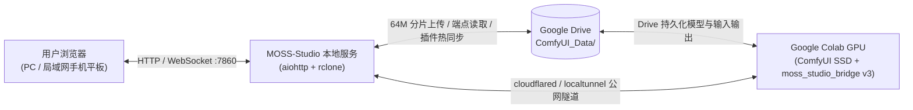

# MOSS-Colab-Studio

> **面向 MOSS-Image 的零滚动暗房工作台 + Google Colab 混合分层 GPU 工作流**
> 免开 Colab 算力即可通过 `rclone` 直传管理 Google Drive LoRA，内置 **INT8 Bypass LoRA QKV 切片与多 LoRA 叠加修复补丁（bridge v3）**，Colab 启动自动握手连接。

[](LICENSE)
[](requirements.txt)
[](ComfyUI_Colab_Hybrid.ipynb)
[](AGENTS.md)

> **English Summary:** MOSS-Colab-Studio pairs a local obsidian-graphite imaging web studio with a hybrid Google Colab ComfyUI runner for **MOSS-Image** (`moss-image-sft-int8`). It includes a runtime ComfyUI patch fixing dropped sliced `proj.qkv.weight` attention layers and multi-LoRA stacking in `LoraLoaderBypassModelOnly`, zero-GPU Google Drive LoRA downloads via `rclone`, 1-second Drive-to-Colab SSD hot-sync, automatic Cloudflare tunnel handshaking, and an interactive visual manga panel layout workbench.

---

## 🤖 AI Agent 一键部署（推荐）

如果你正在使用 **Claude Code、Codex、Cursor、Windsurf、Antigravity、Cline** 等 AI Agent，无需手动逐条敲命令，只需把下面这段话直接发给你的 Agent：

```text
请拉取 GitHub 仓库 https://github.com/yugusu704-lang/moss-colab-studio，严格按照仓库里的 AGENTS.md 完成环境预检（python scripts/check_env.py --json）、依赖安装、rclone 检查与本地服务启动，验证 http://127.0.0.1:7860 正常后把接下来的 Google Drive 授权和 Colab 连接步骤发给我。注意不要把我的任何个人 Key 或本地运行文件提交到 git。
```

---

## ✨ 核心亮点（解决哪些真实痛点）

- **1. 彻底修复 MOSS-Image INT8 Bypass LoRA 丢层与多 LoRA 互相覆盖问题（`bridge v3`）**
  - 原生 ComfyUI 的 `load_bypass_lora_for_models` 对 `moss_image_sft_int8_convrot.safetensors` 这种融合 `proj.qkv.weight` 权重存在兼容缺陷：单独训练 `q/k/v` 的 MOSS LoRA 会被映射为带切片偏移的元组键，原生 `BypassLoRA` 直接丢弃全部 30+ 层注意力 LoRA 并刷屏 `NOT LOADED`；叠加 2 个及以上 Bypass LoRA 时还会互相覆盖。
  - 本项目 [ComfyUI_Colab_Hybrid.ipynb](ComfyUI_Colab_Hybrid.ipynb) 内置 `moss_studio_bridge v3` 运行时补丁（`[MOSS-BypassFix]`）：完整支持切片 QKV 前向增量计算、动态显存卸载（CPU/CUDA）安全设备迁移、多 Bypass LoRA 无损叠加，并自动识别 `pipe.dit.` / `dit.` / `transformer.` 等常见训练器前缀。
- **2. 零 GPU 点数管理模型与 LoRA + 1 秒云盘热同步**
  - 本地集成 `rclone` 一键浏览器 OAuth 授权与本地 Google Drive 同步盘模式，无需启动 Colab 即可浏览、检索、下载 Civitai / Hugging Face 模型并以 `64M` 分片直传至 `ComfyUI_Data/models/loras`。
  - 针对「Colab 已运行后再往 Drive 传新 LoRA 会报 `value_not_in_list`、且 `aria2c -c` 对已存在文件会触发 HTTP 416（退出码 22）」的问题，支持 **「秒同步到 Colab」**（`/moss_studio/sync_drive`）：免重复下载直接拷贝至 Colab 高速 SSD 并刷新 ComfyUI 模型列表缓存。
- **3. 暗房风格「零滚动」全功能生图工作台**
  - 专为长时间视觉审片打造的 Obsidian-Graphite 暗房界面，集成了 **ShinobiSat v2 / 高精度 / 4 步极速** 预设、触发词快捷芯片、`-2.0 ~ +2.0` LoRA 权重滑块（兼容 Slider LoRA）、二修放大 & **SeedVR2** 超分、胶片颗粒、A/B 实时对比滑块、图生图、PNG/WebP 参数反读、漫画分镜自由排版工作台、任务队列与局域网手机/平板访问。
- **4. 免复制公网链接：Notebook 同步与 Colab 自动握手**
  - 一键将本地最新版 Notebook 同步至云盘并绑定直达链接，点击 **「直达 Colab ↗」** 新标签页直开。同时自动下发独立热更新插件 `ComfyUI_Data/moss_studio_bridge.py`，避免 Colab 旧标签页自动保存覆盖更新。
  - Colab Cell 4 启动并拉通隧道后，自动写入 `.moss_studio_endpoint.json`（含 GPU 型号与公网地址），本地工作台点击 **「自动连接」** 即可一键握手接入。

---

## 🏗️ 系统架构



---

## 🚀 手动快速开始

### 1. 环境准备

- **Python 3.10+**
- **[rclone](https://rclone.org/downloads/)**（可选但强烈推荐，用于本地挂载 Google Drive、直传 LoRA 与同步 Notebook）：
  - **Windows**：`winget install -e --id Rclone.Rclone`
  - **macOS**：`brew install rclone`
  - **Linux**：`curl https://rclone.org/install.sh | sudo bash`

### 2. 预检、安装依赖并启动本地工作台

```bash
git clone https://github.com/yugusu704-lang/moss-colab-studio.git
cd moss-colab-studio
python scripts/check_env.py
pip install -r requirements.txt
python moss_studio/server.py
```

Windows 用户也可直接双击根目录的 [启动MOSS本地Web端.bat](启动MOSS本地Web端.bat)。启动后访问：
- 本机工作台：`http://127.0.0.1:7860`
- 局域网访问（手机/平板浏览或提交任务）：启动控制台会自动打印对应的局域网地址

### 3. 挂载 Google Drive 与连接 Colab（省点数三步流）

1. **挂载云盘**：在工作台顶栏点 **「Google Drive」→「一键浏览器授权挂载」** 完成授权（默认目录 `ComfyUI_Data/models/loras`）；如已在 **Civitai 库** 配置你的 Civitai API Key，系统会在同步时自动作为云端桥接鉴权令牌使用。
2. **同步并打开 Notebook**：点击顶栏 **「联动」→「同步本地最新版到云盘」**，再点 **「直达 Colab ↗」**。
3. **Colab 端低成本分步运行**：
   - **首次下载模型（CPU 运行时，不消耗 GPU 点数）**：在 Colab 中运行 **Cell 1 → Cell 3**，将 `moss-image-sft-int8` 主模型、Qwen3.5-9B 文本编码器、FLUX.2 VAE、ShinobiSat 加速包与 SeedVR2 模型并发下载到自己的 Google Drive。
   - **出图阶段（切换 L4 / T4 / A100 GPU 运行时）**：运行 **Cell 1 → Cell 2 → Cell 4**（**跳过 Cell 3**），看到隧道输出后回本地工作台点 **「自动连接」** 即可出图；不用时记得在 Colab 右上角断开并删除运行时。

> Colab 凭证建议优先保存在 Colab 左侧 **Secrets（钥匙图标）** 中（`CIVITAI_TOKEN`、`HF_TOKEN`），也可在本地网页同步后由云盘 `.moss_bridge_token` 自动读取，无需硬编码进 `.ipynb` 文件。

---

## ❓ 常见问题（FAQ）

<details>
<summary>1. 如何确认 Bypass LoRA QKV 修复已经真正生效？</summary>

1. 观察 Colab Cell 4 启动日志，确认出现：
   `[MOSS-BypassFix] Patched comfy.sd.load_bypass_lora_for_models for sliced QKV & multi-LoRA stacking`
2. 挂载包含 `proj.q` / `proj.k` / `proj.v` 的 MOSS LoRA 并出图时，日志只打印简洁的 `[MOSS-BypassFix] Loaded ... adapters (... sliced QKV), total stacked=...`，不再刷屏 `[BypassLoRA] Adapter key not in model state_dict: ... proj.qkv.weight`。
3. 也可直接请求 `<你的ComfyUI隧道地址>/moss_studio/ping`，确认返回 `"bridge_version": 3` 与 `"bypass_qkv_fix": true`。

</details>

<details>
<summary>2. 本地刚传到 Google Drive 的 LoRA，运行中的 Colab 选不到怎么办？</summary>

打开工作台顶部的 **「已有 LoRA」** 库或参数区提示条，点击 **「秒同步到 Colab」** / **「一键秒同步全部」**。工作台会触发 Colab 桥接插件 `/moss_studio/sync_drive`，直接把 Drive 新增文件拷入 Colab 高速 SSD 并清空 `folder_paths.filename_list_cache`，无需重新从 Civitai 下载，也不需要重启 Colab。

</details>

<details>
<summary>3. 为什么同步了新版 Notebook，在旧 Colab 标签页刷新后还是旧代码？</summary>

Colab 浏览器标签页如果一直保持打开，其**自动保存**机制可能会把内存里的旧 `.ipynb` 回写覆盖云盘文件。建议操作方式：
- 方法 A：先关闭旧 Colab 标签页，再在本地点 **「联动 → 同步最新 Notebook」→「直达 Colab ↗」**；
- 方法 B：本项目已支持把最新桥接修复代码独立同步到云盘 `ComfyUI_Data/moss_studio_bridge.py`，Cell 4 每次重启都会自动热加载该文件，不受 `.ipynb` 自动保存覆盖影响。

</details>

---

## 🔒 隐私与安全设计

- **凭证完全留在本地或你自己的私有云盘**：`moss_studio/data/`（含 `config.json`、`rclone.conf`、`history.json`）、`outputs/` 与临时目录均已加入 [`.gitignore`](.gitignore)。
- **公开 Notebook 零硬编码密钥**：[ComfyUI_Colab_Hybrid.ipynb](ComfyUI_Colab_Hybrid.ipynb) 中所有 Token 参数默认为 `""`，仅在运行期从你自己的 Colab Secrets 或你私有 Google Drive 的 `.moss_bridge_token` 读取。

---

## 📁 目录结构

```text
moss-colab-studio/
├── AGENTS.md                    # 通用 AI Agent 自动化部署与排查指南
├── CLAUDE.md                    # Claude Code 入口指引
├── ComfyUI_Colab_Hybrid.ipynb   # Colab 混合分层启动 Notebook（含 bridge v3 与 Bypass QKV 修复）
├── scripts/
│   └── check_env.py             # 零依赖环境预检脚本（支持 --json 输出）
├── 启动MOSS本地Web端.bat          # Windows 一键启动脚本
├── requirements.txt             # Python 依赖（aiohttp, numpy, Pillow）
├── moss_studio/
│   ├── server.py                # 本地 aiohttp 服务、工作流编排与 ComfyUI API 代理
│   ├── gdrive.py                # Google Drive 挂载、LoRA 直传与 Colab 自动握手管理
│   ├── comic_layout.py          # 漫画分镜排版编译模块
│   ├── imgmeta.py               # 生成图片元数据读写与缩略图处理
│   └── static/                  # Obsidian-Graphite 暗房前端界面（零构建纯静态资源）
└── workflows/                   # ComfyUI MOSS-Image 参考工作流模板
```

---

## 📄 开源协议

本项目基于 [MIT License](LICENSE) 开源。
